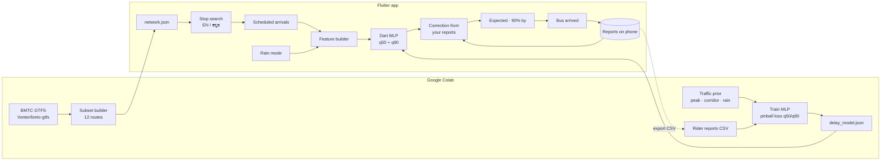
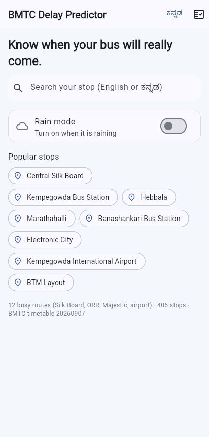
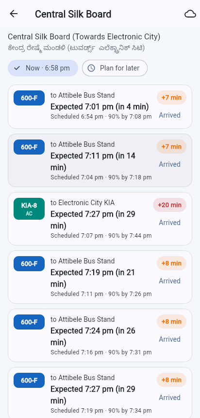
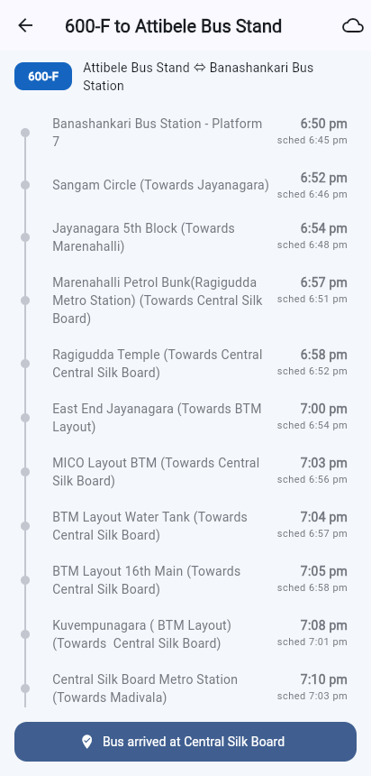
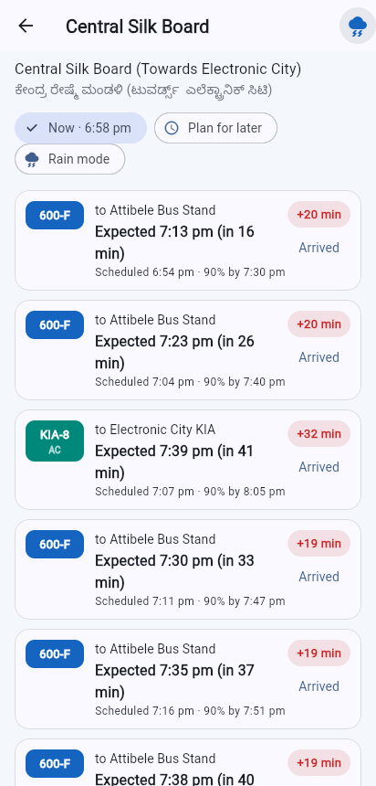

# BMTC Delay Predictor

> Know when your bus will really come.

[](https://github.com/chiragparamesh/bmtc_predictor/actions/workflows/build-apk.yml)

## Problem

BMTC bus arrival times in Bengaluru are unreliable. The timetable says 8:30; the bus shows up at 8:52, or after a heavy shower, much later. Commuters on Silk Board, the Outer Ring Road and Majestic routes plan around guesswork.

This app shows, for any stop on the busiest routes, the **scheduled** time, the **expected** time (schedule + predicted delay) and a **"90% by"** time, so you know when to be at the stop. Riders tap **"Bus arrived"** to collect real ground truth, which corrects the predictions on the phone and is exported to retrain the model in Colab.

## Features

| Feature | Status |
|---|---|
| Bundled timetable for 12 busy routes (Silk Board, ORR, Majestic, airport): 406 stops, 2,625 trips | ✅ Built |
| Stop search in English and Kannada (ಕನ್ನಡ), recent and popular stops | ✅ Built |
| Upcoming buses per stop with scheduled times (peak-hour running times from GTFS) | ✅ Built |
| Predicted delay per stop from a small model trained in Colab (median + 90% quantile) | ✅ Built |
| "90% chance it arrives by 8:42" | ✅ Built |
| Bus timeline: delay building up stop by stop | ✅ Built |
| Rain mode toggle | ✅ Built |
| "Bus arrived" reports stored on the phone | ✅ Built |
| On-device correction from your reports (per-route shrinkage) | ✅ Built |
| Model scorecard on your reports + CSV export for Colab retraining | ✅ Built |
| Plan for a later time | ✅ Built |
| Kannada stop names toggle | ✅ Built |
| Live rainfall from Open-Meteo | 🕓 Planned |
| XGBoost baseline on collected reports | 🕓 Planned |
| Graph neural network over the stop network (delay propagation) | 🕓 Planned |
| Crowd levels | 🕓 Planned |
| "Best time to leave" suggestion | 🕓 Planned |
| Full Kannada UI | 🕓 Planned |

## Architecture



Full design and roadmap: [docs/architecture.md](docs/architecture.md). Training: [ml/README.md](ml/README.md).

## The model

* **Inputs (11):** hour of day (sin/cos), weekend, progress along the trip, minutes since the trip started, corridor flags (ORR, Silk Board, Majestic, airport), AC Vajra, rain intensity.
* **Outputs:** median delay (q50) and the 90th percentile (q90), trained with pinball loss. q90 = q50 + softplus(·), so it can never be below the median.
* **Size:** 11 → 24 → 24 → 2 MLP, 10 KB of JSON weights, evaluated in plain Dart on Android and in Chrome. A Dart-vs-Python parity test checks the exported predictions.
* **Honest status:** no public dataset of real BMTC arrival times exists, so **v0 is trained on a documented traffic prior** (peak hours, corridor, rain, progress), not on observed delays. The app labels it an early estimate. Real "Bus arrived" reports correct it on the phone right away (per-route shrinkage) and are exported to retrain in Colab.

v0 test metrics (on the prior's own held-out samples):

| | Error (minutes) |
|---|---|
| Model median (q50) | **2.36** |
| Baseline: "bus is on schedule" | 5.76 |
| Baseline: median delay for that hour | 3.66 |
| q90 coverage (target 90%) | **89.7%** |

## Tech stack

| Layer | Choice |
|---|---|
| App | Flutter (Dart), Material 3, Riverpod, go_router |
| Transit data | GTFS (community BMTC feed) → compact JSON subset |
| Model | numpy MLP with quantile (pinball) loss, trained in Google Colab |
| On-device inference | Pure Dart (no plugin; works on web and Android) |
| Storage | shared_preferences (reports, rain mode, recent stops) |
| CI | GitHub Actions builds the release APK on every push |

## Tests

```bash
flutter test
```

Timetable lookup (peak profiles, trips crossing midnight, terminating buses), Dart/Python model parity, sanity checks (peak > night, rain > dry), report correction, CSV export, and a widget test for search → stop → "Bus arrived" → reports.

## How to run

```bash
flutter pub get
flutter run -d chrome
```

Install on the phone: push to GitHub, open **Actions → Build APK → latest run**, download the `bmtc_predictor-release-apk` artifact and install it on the Pixel 9a. APKs are never built locally.

Retrain the model: open `ml/notebooks/01_train_delay_model.ipynb` in Google Colab (see [ml/README.md](ml/README.md)).

## Screenshots

Web preview (Chrome), weekday evening peak:

| Home | Central Silk Board | Bus timeline | Rain mode |
|---|---|---|---|
|  |  |  |  |

## Data and licence

Timetable data: BMTC via the Namma BMTC app, compiled by [Vonter/bmtc-gtfs](https://github.com/Vonter/bmtc-gtfs), licensed under the [Open Database License (ODbL) 1.0](https://opendatacommons.org/licenses/odbl/1-0/). The subset in `assets/data/network.json` is a derived database, also under ODbL 1.0. The source notes that the Namma BMTC timetables are themselves imperfect.
