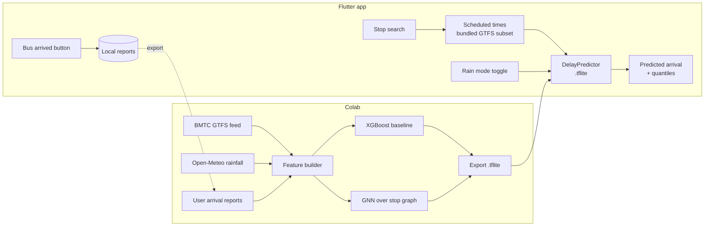

# BMTC Delay Predictor

> Know when your bus will really come.

[](https://github.com/chiragparamesh/bmtc_predictor/actions/workflows/build-apk.yml)

## Problem

BMTC bus arrival times in Bengaluru are unreliable. The timetable says 8:30; the bus shows up at 8:52, or after a heavy shower, not at all. Commuters on Silk Board, the Outer Ring Road and Majestic routes plan around guesswork.

This app predicts the **delay per stop** using the community BMTC GTFS feed ([Vonter/bmtc-gtfs](https://github.com/Vonter/bmtc-gtfs)) and Open-Meteo rainfall data, and collects ground truth from riders through a one-tap "bus arrived" report.

## Features

| Feature | Status |
|---|---|
| Project skeleton, theme, routing, CI APK build | ✅ Built |
| Bundled GTFS subset of busy routes (Silk Board, ORR, Majestic) | 🕓 Planned |
| Stop search | 🕓 Planned |
| Scheduled times per stop | 🕓 Planned |
| Predicted delay from a small Colab-exported model | 🕓 Planned |
| Rain mode toggle | 🕓 Planned |
| "Bus arrived" report button, stored locally | 🕓 Planned |
| XGBoost baseline on GTFS + Open-Meteo rainfall | 🕓 Planned |
| Graph neural network over the stop network (delay propagation) | 🕓 Planned |
| Quantile predictions ("90% chance it arrives by 8:42") | 🕓 Planned |
| Crowd levels | 🕓 Planned |
| "Best time to leave" suggestion | 🕓 Planned |
| Kannada / English UI | 🕓 Planned |

## Architecture



Full design and roadmap: [docs/architecture.md](docs/architecture.md).

## Tech stack

| Layer | Choice |
|---|---|
| App | Flutter (Dart), Material 3, go_router |
| Transit data | GTFS static feed (community BMTC GTFS) |
| Weather | Open-Meteo (free, no API key) |
| Models | XGBoost baseline → graph neural network (PyTorch Geometric), trained in Google Colab |
| On-device inference | TensorFlow Lite |
| Local storage | Arrival reports stored on-device |
| CI | GitHub Actions builds the release APK on every push |

## How to run

```bash
flutter pub get
flutter run -d chrome
```

Install on the phone: push to GitHub, open **Actions → Build APK → latest run**, download the `bmtc_predictor-release-apk` artifact and install `app-release.apk` on the Pixel 9a. APKs are never built locally.

## Screenshots

_Coming soon._

| Stop search | Prediction | Rain mode |
|---|---|---|
| _todo_ | _todo_ | _todo_ |
