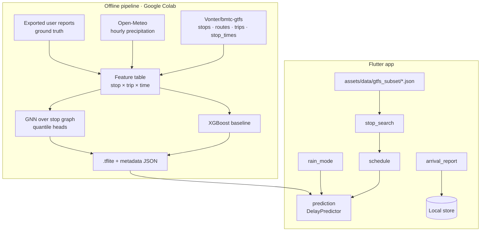

# BMTC Delay Predictor — Architecture

## 1. Goal

For a chosen stop and route, show the scheduled arrival, the **predicted delay**, and eventually a calibrated range ("90% chance it arrives by 8:42") plus a "best time to leave" suggestion. All inference runs on the phone.

## 2. System overview



## 3. Data

### 3.1 GTFS subset (bundled)

The full feed is large. A Colab script filters it to the busy corridors (Silk Board, Outer Ring Road, Majestic) and writes compact JSON into `assets/data/gtfs_subset/`:

| File | Contents |
|---|---|
| `stops.json` | `id`, `name`, `name_kn`, `lat`, `lon` |
| `routes.json` | `id`, `short_name`, `long_name` |
| `trips.json` | `trip_id`, `route_id`, `direction`, `service_days` |
| `stop_times.json` | `trip_id`, `stop_id`, `sequence`, `scheduled_time` |
| `edges.json` | consecutive-stop edges for the graph model |

### 3.2 Weather

Open-Meteo hourly precipitation for Bengaluru (historical API for training, forecast API at runtime later). In the current scope, **rain mode** is a manual toggle that sets the rain feature to a "heavy rain" value.

### 3.3 Ground truth

GTFS is a schedule, not real arrivals. Ground truth comes from riders tapping **"Bus arrived"**: `{stop_id, route_id, trip_id?, reported_at, scheduled_at, raining}`. Stored locally now; later uploaded (opt-in) to a free backend and exported to Colab for retraining. Until enough reports exist, the model is bootstrapped with heuristics (time-of-day congestion priors, corridor, rain) and clearly labeled as an early estimate.

## 4. Models

| Stage | Model | Output |
|---|---|---|
| Baseline | XGBoost regressor on tabular features | delay minutes |
| Quantiles | XGBoost / GNN with pinball loss at q = 0.5, 0.9 | median + P90 delay |
| Graph | GNN (GraphSAGE / temporal GCN) over the stop graph | per-stop delay; upstream delays propagate downstream |

Features: hour-of-day, day-of-week, holiday flag, stop sequence index, distance from origin, corridor, rain intensity, recent reported delays upstream (for the graph model).

**Export path:** XGBoost has no direct TFLite export. Options: (a) distill the XGBoost predictions into a small Keras MLP and export that, (b) export trees to JSON and evaluate them in Dart. The GNN is exported as a fixed-graph model (adjacency baked in) through PyTorch → ONNX → TFLite or `ai-edge-torch`. The app talks only to a `DelayPredictor` interface, so the model can be swapped.

**Web preview rule:** TFLite does not run on Flutter web; Chrome uses a heuristic `DelayPredictor` implementation.

## 5. App layers

```
lib/core/services/   DelayPredictor interface, local storage, (later) location
lib/features/
  stop_search/       search over stops.json (name + Kannada name)
  schedule/          next departures for a stop from stop_times.json
  prediction/        DelayPredictor (heuristic on web, tflite on Android)
  rain_mode/         toggle feeding the predictor
  arrival_report/    "Bus arrived" button, local persistence, export
```

## 6. Roadmap

| Phase | Scope |
|---|---|
| 0 ✅ | Skeleton, theme, router, CI APK build |
| 1 | Colab: GTFS subset → bundled JSON; stop search and scheduled times |
| 2 | Heuristic predictor + rain mode; "bus arrived" reports stored locally |
| 3 | XGBoost baseline in Colab; distilled TFLite model on-device |
| 4 | Quantile predictions and "best time to leave" |
| 5 | Opt-in report upload; retraining loop |
| 6 | GNN over the stop network; crowd levels; Kannada / English UI |

## 7. Evaluation

- MAE of delay (minutes) per corridor and per rain condition.
- Quantile calibration: share of arrivals before the P90 time (target ≈ 90%).
- Baseline to beat: "scheduled time + historical mean delay for this hour".
