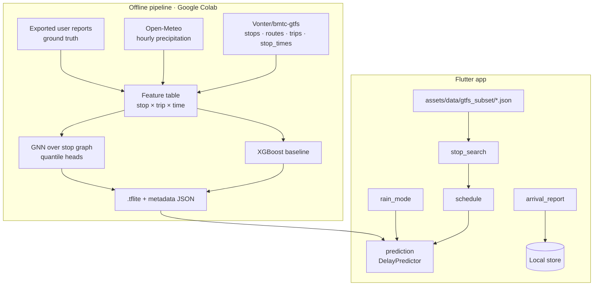

# BMTC Delay Predictor — Architecture

## 1. Goal

For a chosen stop and route, show the scheduled arrival, the **predicted delay**, and eventually a calibrated range ("90% chance it arrives by 8:42") plus a "best time to leave" suggestion. All inference runs on the phone.

## 2. System overview



## 3. Data

### 3.1 GTFS subset (bundled)

The full feed is large (1.5M stop times). `ml/tools/build_network.py` filters it to 12 busy routes (500-D, V-500D, 500-A, 500-F, 600-F, MF-5, KIA-8, KIA-9, KBS-3A, 25-A, 90-E, 300-MV) and writes one compact file, `assets/data/network.json` (168 KB, ODbL 1.0):

| Key | Contents |
|---|---|
| `routes` | `id`, `short`, `long`, `vajra`, `corridors` (orr, silk_board, majestic, airport) |
| `stops` | `id`, `name`, `desc` (with direction), `kn` (Kannada), `lat`, `lon` |
| `patterns` | per route+direction stop sequence; `profiles` = seconds-from-start per stop (BMTC uses slower running times at peak); `trips` = [start second, profile index] |

Patterns + profiles compress 80k stop-time rows into about 170 KB. Consecutive stops in a pattern are the edges for the future graph model.

### 3.2 Weather

Open-Meteo hourly precipitation for Bengaluru (historical API for training, forecast API at runtime later). In the current scope, **rain mode** is a manual toggle that sets the rain feature to a "heavy rain" value.

### 3.3 Ground truth

GTFS is a schedule, not real arrivals. Ground truth comes from riders tapping **"Bus arrived"**: `{stop_id, route_id, trip_id?, reported_at, scheduled_at, raining}`. Stored locally now; later uploaded (opt-in) to a free backend and exported to Colab for retraining. Until enough reports exist, the model is bootstrapped with heuristics (time-of-day congestion priors, corridor, rain) and clearly labeled as an early estimate.

## 4. Models

| Stage | Model | Output |
|---|---|---|
| Baseline | XGBoost regressor on tabular features | delay minutes |
| Quantiles | XGBoost / GNN with pinball loss at q = 0.5, 0.9 | median + P90 delay |
| Graph | GNN (GraphSAGE / temporal GCN) over the stop graph | per-stop delay; upstream delays propagate downstream |

Features: hour-of-day, day-of-week, holiday flag, stop sequence index, distance from origin, corridor, rain intensity, recent reported delays upstream (for the graph model).

**Shipped (v0):** an 11 → 24 → 24 → 2 MLP trained with pinball loss (q50, q90 = q50 + softplus), exported as JSON weights and evaluated in plain Dart, so the same model runs on Android and in Chrome. Labels come from a documented traffic prior (ml/README.md) because no public arrival data exists. Test metrics on the prior: q50 MAE 2.36 min vs 5.76 (schedule) and 3.66 (hour median); q90 coverage 89.7%.

**On-device learning:** `ModelDelayPredictor` shifts each route's predictions by `mean(actual − predicted) × n/(n+3)` from the rider's reports, so a handful of reports already help, without retraining.

**Export path later:** XGBoost has no direct TFLite export, so either distil it into the MLP or export trees to JSON and evaluate them in Dart. The GNN is exported as a fixed-graph `.tflite` (Android) behind the same `DelayPredictor` interface, with the MLP as the web fallback.

## 5. App layers

```
lib/core/services/   DelayPredictor interface, local storage, (later) location
lib/features/
  stop_search/       search over stops.json (name + Kannada name)
  schedule/          next departures for a stop from stop_times.json
  prediction/        DelayPredictor (heuristic on web, tflite on Android)
  rain_mode/         toggle feeding the predictor
  arrival_report/    "Bus arrived" button, local persistence, export
```

## 6. Roadmap

| Phase | Scope |
|---|---|
| 0 ✅ | Skeleton, theme, router, CI APK build |
| 1 ✅ | GTFS subset → bundled JSON; stop search (EN/ಕನ್ನಡ) and scheduled times |
| 2 ✅ | Prior-trained MLP (q50/q90) + rain mode; "bus arrived" reports stored locally, on-device correction, CSV export |
| 3 | XGBoost baseline in Colab; distilled TFLite model on-device |
| 4 | "Best time to leave" (quantiles ✅ already built) |
| 5 | Opt-in report upload; retraining loop |
| 6 | GNN over the stop network; crowd levels; Kannada / English UI |

## 7. Evaluation

- MAE of delay (minutes) per corridor and per rain condition.
- Quantile calibration: share of arrivals before the P90 time (target ≈ 90%).
- Baseline to beat: "scheduled time + historical mean delay for this hour".
